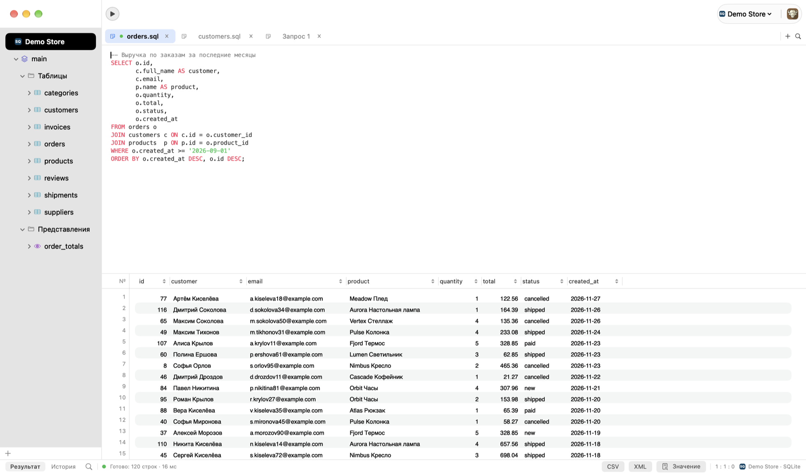

<h1> DBooyvol</h1>

Простой нативный клиент для баз данных на macOS: дерево объектов, редактор SQL
с подсветкой, выполнение запросов через JDBC, история, таблица результатов и
экспорт в CSV/XML.

**Поддерживаемые базы:** PostgreSQL, Oracle, ClickHouse, SQLite. Любую другую
СУБД можно подключить своим JDBC-драйвером через поле «JDBC URL» в профиле.

**Языки интерфейса:** английский, арабский, вьетнамский, индонезийский,
испанский, итальянский, китайский (упрощённый и традиционный), корейский,
немецкий, нидерландский, польский, португальский, русский, тайский, турецкий,
украинский, французский, хинди, чешский, шведский, японский.



## Возможности

- Подключения к PostgreSQL, Oracle, ClickHouse и SQLite; пароли хранятся в
  зашифрованном виде.
- Дерево баз, схем, таблиц и столбцов; типы столбцов показываются при наведении.
- Несколько вкладок с запросами, переименование, дублирование и перетаскивание.
  У каждого скрипта своё подключение.
- Редактор SQL с подсветкой, автодополнением скобок и комментированием строк.
- Выполнение выделения или всего скрипта, отмена запроса, постраничная загрузка.
- Сортировка и выделение столбцов в результатах, настройка ширины столбцов.
- Поиск по открытым вкладкам, по тексту скрипта и по результатам — в любой
  раскладке клавиатуры.
- История запросов и экспорт результатов в CSV/XML.
- Открытие файлов `.sql` как скриптов, а `.db` / `.sqlite` — как баз SQLite.
- SSH-туннель для подключений к удалённым серверам.
- Настройка шрифтов редактора и результатов, размера страницы и вида окна.

## Сборка

```bash
./Sidecar/build.sh          # собирает Resources/sidecar.jar (нужен JDK 11+)
xcodegen generate           # создаёт DBooyvol.xcodeproj
xcodebuild -project DBooyvol.xcodeproj -scheme DBooyvol -configuration Debug \
           -derivedDataPath build CODE_SIGNING_ALLOWED=NO build
open build/Build/Products/Debug/DBooyvol.app
```

Или просто `make build`. Номер сборки увеличивается автоматически при каждой
сборке через `make`.

Структура проекта:

```
Sources/            Swift/AppKit приложение
Sidecar/            Java-процесс для JDBC
Resources/          sidecar.jar и JDBC-драйверы
project.yml         описание проекта для XcodeGen
```

## Лицензия

Проект распространяется по лицензии MIT. Подробности — в файле [LICENSE](LICENSE).

Репозиторий: <https://github.com/silverjohnes/dbooyvol-mac>
